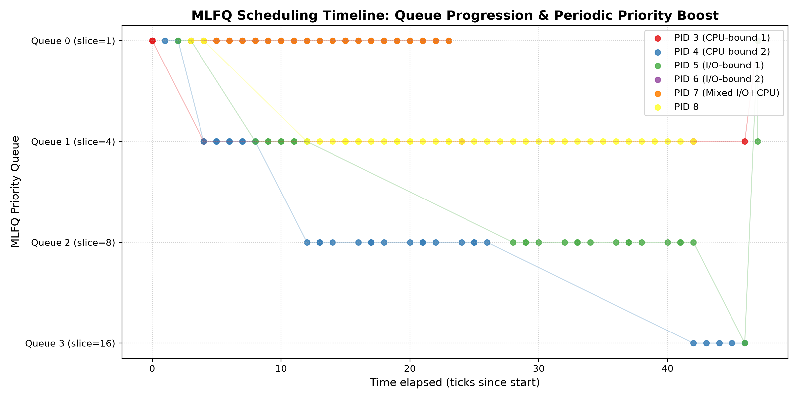

# iV6: Enhanced RISC-V Operating System

[]()
[]()
[]()
[](LICENSE)

**iV6** is an extended, full-featured operating system based on the MIT xv6-riscv kernel. It incorporates major operating system features across core subsystems: advanced CPU scheduling (a 4-level Multi-Level Feedback Queue and First-Come-First-Served), process performance telemetry (`waitx`), user-level timer interrupts and alarms (`sigalarm` / `sigreturn`), a complete Copy-on-Write (COW) virtual memory subsystem with physical page reference counting, and a POSIX-compliant symbolic link subsystem with loop prevention.

Developed by **Mohammed Ibrahim bin Faisal** ([@ibrah1m208](https://github.com/ibrah1m208)).

---

## Table of Contents

- [Subsystem Features](#subsystem-features)
  - [1. CPU Scheduling: Multi-Level Feedback Queue (MLFQ)](#1-cpu-scheduling-multi-level-feedback-queue-mlfq)
  - [2. Process Performance Accounting (`waitx`)](#2-process-performance-accounting-waitx)
  - [3. User Alarms (`sigalarm` & `sigreturn`)](#3-user-alarms-sigalarm--sigreturn)
  - [4. Copy-on-Write (COW) Fork](#4-copy-on-write-cow-fork)
  - [5. Symbolic Links & File System Extensions](#5-symbolic-links--file-system-extensions)
  - [6. Diagnostics & Process Inspection](#6-diagnostics--process-inspection)
- [Performance & Benchmark Analysis](#performance--benchmark-analysis)
  - [Cross-Scheduler Comparison](#cross-scheduler-comparison)
  - [MLFQ Process Timeline](#mlfq-process-timeline)
- [Repository Structure](#repository-structure)
- [Getting Started](#getting-started)
  - [Prerequisites](#prerequisites)
  - [Compilation & Running](#compilation--running)
- [Running Tests & Benchmarks](#running-tests--benchmarks)
- [License](#license)

---

## Subsystem Features

### 1. CPU Scheduling: Multi-Level Feedback Queue (MLFQ)

iV6 introduces a multi-tier MLFQ scheduler designed to minimize response time for interactive processes while preventing starvation for CPU-intensive tasks:

- **4 Priority Queues (Levels 0–3)**:
  - **Queue 0 (Highest Priority)**: Time slice = **1 timer tick**
  - **Queue 1**: Time slice = **4 timer ticks**
  - **Queue 2**: Time slice = **8 timer ticks**
  - **Queue 3 (Lowest Priority)**: Time slice = **16 timer ticks**
- **Strict Priority Preemption**: A runnable process in a higher-priority queue immediately preempts any running process in a lower-priority queue.
- **Queue Servicing Disciplines**:
  - **Queues 0–2**: Serviced via First-In-First-Out (**FIFO**) ordering using monotonic entry sequence IDs (`mlfq_enter_seq`).
  - **Queue 3**: Serviced via **Round-Robin** across all tasks at the lowest level.
- **Dynamic Demotion**: If a process completely consumes its allocated time slice without relinquishing the CPU, it is demoted to the next lower queue (`mlfq_queue++`) and placed at the tail.
- **Voluntary Yield Preservation (I/O Friendliness)**: If a process voluntarily relinquishes CPU control before exhausting its slice (e.g. entering `sleep()` on I/O), its current priority level is preserved, resetting only its consumed slice ticks.
- **Anti-Starvation Priority Boosting**: Every **48 timer ticks**, all active processes in the system are boosted back to Queue 0, preventing indefinite starvation of low-priority CPU-bound processes.
- **Multi-Policy Support**: Easily selectable at compile-time between default Round Robin, FIFO, and MLFQ via `SCHEDULER=<TYPE>`.

---

### 2. Process Performance Accounting (`waitx`)

- **`waitx` System Call**:
  ```c
  int waitx(int *status, int *wtime, int *rtime, int *stime);
  ```
  Extends standard `wait()` to retrieve comprehensive process metrics upon exit:
  - `status`: Process exit status.
  - `wtime`: Total ticks spent waiting in the ready queue.
  - `rtime`: Total ticks actively running on the CPU.
  - `stime`: Ticks elapsed until first CPU acquisition (Response Time).
- **Kernel-Level Bookkeeping**: Added `ctime` (creation tick), `stime` (first scheduled tick), `etime` (exit tick), and `rtime` (execution ticks) directly inside `struct proc`.

---

### 3. User Alarms (`sigalarm` & `sigreturn`)

Enables user-space programs to register periodic timer callbacks for profiling, timeouts, and asynchronous event loops:

- **`sigalarm` System Call**:
  ```c
  int sigalarm(int ticks, void (*handler)());
  ```
  Instructs the kernel to invoke the user function `handler` every `ticks` CPU timer ticks consumed by the process.
- **`sigreturn` System Call**:
  ```c
  int sigreturn(void);
  ```
  Invoked at the end of the user alarm handler to safely restore the interrupted register state (`p->trapframe` preserved in `alarm_tf`) so that application code resumes seamlessly without clobbering caller-saved or return registers.
- **Reentrancy Protection**: The kernel sets `p->alarm_executing = 1` while a handler is active, preventing reentrant handler invocations until `sigreturn()` has been called.

---

### 4. Copy-on-Write (COW) Fork

Optimizes process creation by deferring physical page allocations until write time, drastically reducing memory footprint and `fork()` latency:

- **Reference-Counted Physical Allocator (`kernel/kalloc.c`)**:
  - Global reference table `page_ref.count[NUM_PHYS_PAGES]` protected by spinlock `page_ref.lock`.
  - Increments reference counts on page sharing via `kref_inc()`.
  - Decrements reference counts on `kfree()`, freeing the underlying physical page only when all references reach zero.
- **Virtual Memory Sharing (`kernel/vm.c`)**:
  - `uvmcopy()` eliminates upfront memory allocation and page copying during `fork()`.
  - Child page tables map the parent's physical pages directly.
  - Writable pages have their write permission cleared (`~PTE_W`) and are tagged with the custom flag `#define PTE_COW (1L << 8)`.
- **Fault-Driven Duplication (`cowfault()`)**:
  - Handles page fault traps (`scause == 15`) generated when either process writes to a shared COW page.
  - **Single Reference**: If the page is referenced by only one process, write permission is re-enabled in-place (`PTE_W`) and `PTE_COW` is cleared without copying.
  - **Multiple References**: A fresh physical page is allocated via `kalloc()`, populated with the existing data via `memmove()`, and mapped with `PTE_W`, while the old page's reference count is decremented.
- **Kernel Interception (`copyout()`)**: Ensures kernel operations writing directly to user virtual addresses trigger `cowfault()` before copying.

---

### 5. Symbolic Links & File System Extensions

A complete POSIX-style symbolic link implementation inside the xv6 file system:

- **`symlink` System Call**:
  ```c
  int symlink(const char *target, const char *path);
  ```
  Creates an inode of type `T_SYMLINK` holding the target pathname.
- **Support for Dangling Symlinks**: Allows creating links to targets that do not yet exist, matching standard Unix behavior.
- **Recursive Symlink Resolution in `sys_open()`**:
  - Automatically traverses and resolves chains of symbolic links during path lookup.
  - **Cycle & Recursion Limit**: Detects circular symlink loops by enforcing a maximum traversal depth (`MAX_DEPTH = 10`), cleanly terminating with an error when exceeded.
  - **`O_NOFOLLOW` Flag**: Added to `kernel/fcntl.h`, allowing system calls to open the symlink file itself without dereferencing its target.
- **User-Space Tools**:
  - `ln -s <target> <link>`: CLI utility to create symbolic links.
  - `readlink <path>`: Prints the contents of a symbolic link without resolving.

---

### 6. Diagnostics & Process Inspection

- **Enhanced Process Dump (`Ctrl+P`)**:
  Under `SCHEDULER_MLFQ`, console process dumps display real-time queue states:
  ```text
  PID  STATE     NAME        Q   TICKS_USED   TOTAL_TICKS   TICKS_SINCE_BOOST
  1    SLEEPING  init        0   0            1             5
  2    SLEEPING  sh          0   0            1             5
  4    RUNNABLE  schedulert  3   4            32            12
  ```
- **Automated Scheduler Benchmark (`benchmark.py`)**: Automates execution under QEMU, parses `schedulertest` logs, generates scheduling metrics tables, and plots process queue timelines.
- **Automated xv6 Test Runner (`test-xv6.py`)**: Runs kernel tests (`usertests`, `alarmtest`, `cowtest`, `symlinktest`) non-blockingly with timeout safeguards.

---

## Performance & Benchmark Analysis

### Cross-Scheduler Comparison

All three scheduling algorithms were evaluated using the identical 5-process benchmark workload (`schedulertest`):
- **CPU-bound tasks (PID 4, 5)**: Long computational loops.
- **I/O-bound tasks (PID 6, 7)**: Frequent short bursts followed by `sleep(1)`.
- **Mixed tasks (PID 8)**: Moderate computation bursts followed by `sleep(2)`.

| Scheduling Algorithm | Avg Turnaround Time (ticks) | Avg Waiting Time (ticks) | Avg Response Time (ticks) |
|---|:---:|:---:|:---:|
| **Round Robin (RR)** | 33.00 | 12.00 | **0.20** |
| **FIFO (FCFS)** | 98.20 | 72.20 | 63.00 |
| **MLFQ** | 35.20 | 26.00 | **1.40** |

#### Key Insights:
1. **Response Time**: Both Round Robin (0.20 ticks) and MLFQ (1.40 ticks) offer vastly superior interactive responsiveness compared to FIFO (63.00 ticks), eliminating the classic "convoy effect".
2. **Fairness vs. Overhead**: While Round Robin achieves low waiting times via frequent preemptive switching, MLFQ allocates longer slices (up to 16 ticks) to compute-heavy tasks while keeping interactive tasks pinned at Queue 0, reducing context switch overhead while maintaining near-instant response times.

### MLFQ Process Timeline

The scatter plot below visualizes process priority queue migrations over time under MLFQ:



- **I/O-bound processes (green/red)** remain pinned at **Queue 0**, receiving immediate attention whenever runnable.
- **CPU-bound processes (blue/orange)** consume their slices and cascade down through **Queue 1** and **Queue 2** to **Queue 3**, where they execute in round-robin fashion with large quanta (16 ticks).
- **Periodic Boost**: At **tick 48**, all active processes are boosted back to Queue 0, preventing starvation.

---

## Repository Structure

```
.
├── Makefile              # Build configuration (SCHEDULER=MLFQ|FIFO, toolchain flags)
├── benchmark.py          # Benchmark runner and timeline graph generator
├── mlfq_timeline.png     # Scatter plot of MLFQ process migrations
├── report.md             # Detailed empirical analysis report on scheduling
├── test-xv6.py           # Automated QEMU test harness
├── kernel/               # RISC-V Kernel Subsystem
│   ├── defs.h            # Kernel function declarations (COW, MLFQ, alarms, kwaitx)
│   ├── fcntl.h           # File control flags (O_APPEND, O_NOFOLLOW)
│   ├── fs.c / fs.h       # File system implementation
│   ├── kalloc.c          # Physical memory allocator with page reference counts
│   ├── proc.c / proc.h   # Process table, MLFQ/FIFO schedulers, alarm state
│   ├── riscv.h           # RISC-V definitions & PTE_COW bit (RSW 8)
│   ├── stat.h            # Inode types (T_DIR, T_FILE, T_DEVICE, T_SYMLINK)
│   ├── syscall.c / .h    # System call dispatch table (waitx, sigalarm, sigreturn, symlink)
│   ├── sysfile.c         # File system calls (sys_symlink, recursive sys_open)
│   ├── sysproc.c         # Process system calls (sys_waitx, sys_sigalarm, sys_sigreturn)
│   ├── trap.c            # Trap dispatch, cowfault handler, timer alarm trigger
│   └── vm.c              # Virtual memory, lazy COW uvmcopy, is_cow_page, cowfault
└── user/                 # User-Space Utilities & Test Suites
    ├── alarmtest.c       # Comprehensive user alarm test suite
    ├── cowtest.c         # Copy-on-Write fork stress test suite
    ├── ln.c              # Link utility with symbolic link support (-s flag)
    ├── readlink.c        # Utility to read symlink targets
    ├── schedulertest.c   # Multi-process scheduler benchmark program
    ├── symlinksmoke.c    # Basic symlink sanity test
    ├── symlinktest.c     # Exhaustive symlink test suite
    ├── user.h / usys.pl  # System call stubs and library prototypes
    └── usertests.c       # Comprehensive xv6 regression test suite
```

---

## Getting Started

### Prerequisites

You need a RISC-V cross-compiler toolchain and QEMU:

```bash
# Debian / Ubuntu
sudo apt-get update
sudo apt-get install gcc-riscv64-linux-gnu g++-riscv64-linux-gnu qemu-system-misc
```

### Compilation & Running

iV6 provides an interactive `help` target:

```bash
make help
```

#### 1. Boot with Default Round-Robin Scheduler:
```bash
make clean
make qemu
```

#### 2. Boot with MLFQ Scheduler (Deterministic Single-Core):
```bash
make clean
make qemu SCHEDULER=MLFQ
```

#### 3. Boot with FIFO / FCFS Scheduler:
```bash
make clean
make qemu SCHEDULER=FIFO
```

To exit QEMU at any time, press `Ctrl+A` then `X`.

---

## Running Tests & Benchmarks

### Inside xv6 Shell

Once booted into the xv6 shell:

1. **Test Copy-on-Write (COW)**:
   ```sh
   $ cowtest
   ```
2. **Test User Alarms (`sigalarm`/`sigreturn`)**:
   ```sh
   $ alarmtest
   ```
3. **Test the Scheduler**:
   ```sh
   $ schedulertest
   ```
4. **Test Symbolic Links**:
   ```sh
   $ symlinksmoke
   $ symlinktest
   ```
5. **Use `ln -s` and `readlink`**:
   ```sh
   $ echo "hello iV6" > original.txt
   $ ln -s original.txt mylink
   $ readlink mylink
   original.txt
   $ cat mylink
   hello iV6
   ```
6. **Run Full Kernel Regression Tests**:
   ```sh
   $ usertests -q
   ```

### Host-Side Automated Benchmarks

From the host terminal:

```bash
# Run the scheduler benchmark and regenerate plots
python3 benchmark.py

# Run automated tests through the QEMU test harness
python3 test-xv6.py -q usertests
```

---

## License

iV6 is distributed under the terms of the **MIT License**, consistent with the upstream MIT xv6-riscv project. See [LICENSE](LICENSE) for details.
